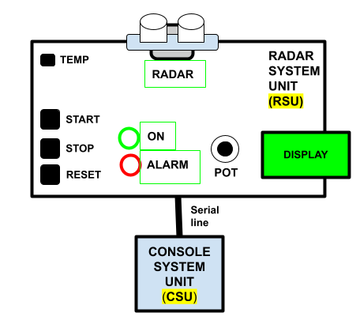

### Embedded Systems and IoT  - ISI LT - a.y. 2025/2026

## Assignment #02 - *Smart Radar System (SRS)* 

v. 1.0.0-20261104
 
We want to realise an embedded system implementing a *smart radar*, for monitoring and detecting objects. 

### Description 

#### Components

The system is composed by two subsystems: 

- **RADAR SUBSYSTEM (RSU)**, based on Arduino 
  - **RADAR** is a sonar, mounted on top of a servo motor
  - **START**, **STOP** and **RESET** are two tactile buttons
  - **ON** and **ALARM;** are two leds,  green and red
  - **POT** is a potentiometer
  - **DISPLAY** is an LCD, based on I2C
  - **TEMP** is an analog temperature sensor (TMP36 or LM35)
- **CONSOLE SUBSYSTEM (CSU)**, running on the PC
  - A GUI-based (or CLI-based) program, communicating via **serial line** with the RSU.  

#### Behaviour: RSU Subsystem

When booted, the RSU subsystem is in *idle*: everything is off and the MCU is in deep sleep.  By pressing **START**, the subsystem starts *working*:
- the **ON** LED is turned on, the **RADAR** is positioned to 0° and then starts spanning the horizon (180 degrees) to detect objects, rotating forward and backward, at some speed S1
- The 180 degrees are divided in N sectors: the **RADAR** rotates sector by sector, detecting for each sector if there is object and at which distance 
  - the temperature sensor **TEMP** is used to calibrate the Sonar sensing, i.e. the sound speed.
- The information about the sector number visited (1..N) and if an object is detected are visualised on **DISPLAY** and sent to the CSU subsystem (described later). 

If an object is detected in any sector at a distance included between D1 and D2, the system enters in *pre-alarm* state:
- in *pre-alarm*, the radar speed is increased to S2 (greater than S1), and **ALARM** led is turned on.
- The system exists from the *pre-alarm* state if no objects are detected in a distance less than D2. 

If an object is detected at distance less than D1, the system enters in *alarm* state:
- In *alarm* state, **ALARM** led start blinking at some frequency, and the **RADAR** position is controlled manually, by a human operator through the **POT** potentiometer.
- The system exists from the *alarm* state only when the operator presses the **RESET** button: in that case the **RADAR** position is reset, **ALARM** led turned off and the system starts working normally.

#### Behaviour: CSU Subsystem

The Console Subsystem (CSU) shows the current state of the RSU (idle, working, pre-alarm, alarm). It can have a GUI or being based on a CLI.
- When it is working, it is shows the current state of the N sectors, reporting for each sector if an object has been detected or not and at which distance.

*Optional Part*

The CSU includes also proper input controls to activate, when needed, the remote control of the **RADAR**. 
- a **TAKE CONTROL** button, to start the remote controlling
- input controls for controlling the **RADAR** position
- a **RESET** button, to reset the system in *alarm* state
- a **RELEASE CONTROL** button, to release the control

### The assignment

Develop the embedded software on Arduino + PC connected through the serial line, implementing the Arduino part (the Radar System Unit) in C++/Wiring e the PC part (the Console Subsystem Unit) in Java or in your favourite language.  **The Arduino program must be designed and implemented using task-based architectures and synchronous Finite State Machines**.

For any aspect not specified, you are free to choose the approach you consider more useful or valuable.

**The Deliverable**

The deliverable consists in a zipped folder `assignment-02.zip` including three directories:
- `radar-subsystem-unit`, including the source code of Arduino-based part
- `console-subsystem-unit`, including the source code of the PC-based part
- `doc`, including:  a brief **report** describing the solution, in particular the diagram of the FSMs and the  representation of the schema/breadboard – using tools such as TinkerCad or Fritzing , and a **short video** (or the link to a video on the UNIBO OneDrive cloud) demonstrating the system.

